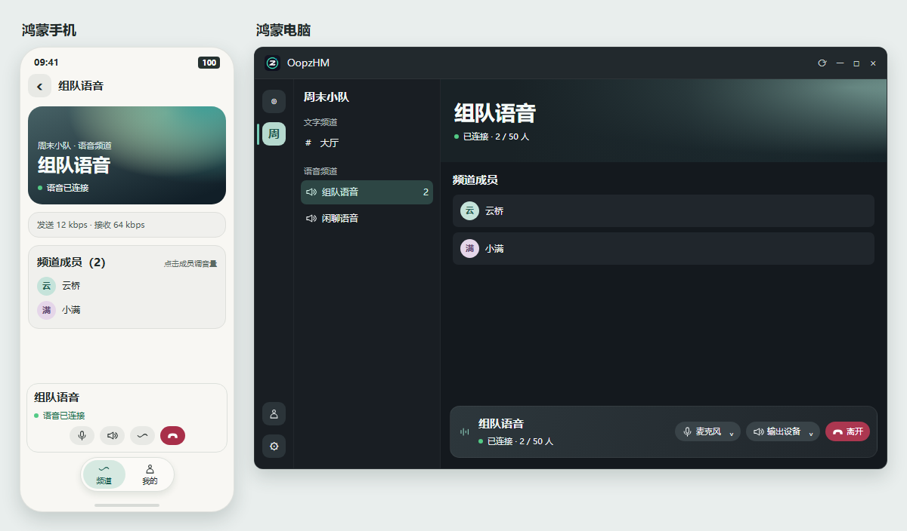
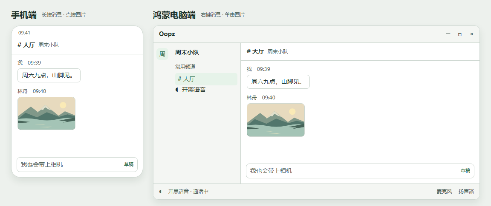
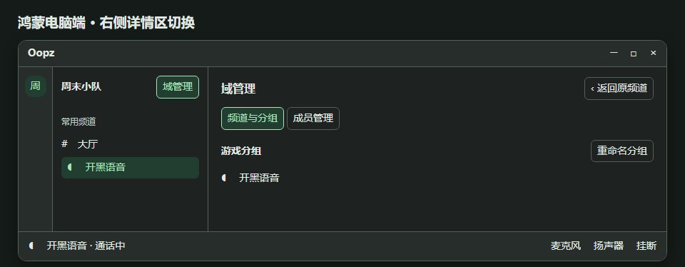

# OopzHM

OopzHM 是个人开发的 Oopz 鸿蒙原生客户端，面向鸿蒙手机、平板和电脑。应用使用 ArkTS 和 ArkUI 构建界面，并通过声网鸿蒙 SDK 收发语音。项目目前用于开发和测试。

## 主要功能

- **域与频道**。原生登录后浏览已加入的域、频道分组和语音频道成员。
- **文字聊天**。发送文字、表情和图片，引用回复消息，查看频道未读提醒。
- **实时语音**。加入语音频道、开关麦克风、调节发送增益与成员播放音量。在支持的设备上可切换音频线路，并在后台或锁屏时保持通话。
- **域管理**。按账号在域内的权限管理成员、频道和频道分组。

## 界面预览

语音频道在手机上使用独立通话页，鸿蒙电脑同时显示域、频道和成员。

手机与鸿蒙电脑的文字频道，包含消息、图片和通话状态。

鸿蒙电脑可在当前窗口查看域管理，同时保留频道列表和通话控制。

语音频道图按本地运行截图重绘。所有插图使用演示域、昵称、头像和消息。

## 鸿蒙原生能力

| 能力 | 应用内的使用场景 |
| --- | --- |
| ArkUI 与系统主题 | 手机使用逐页导航，鸿蒙电脑使用多栏布局。浅色和深色可跟随系统或手动选择，支持沉浸光感材质的设备可在弹层使用系统材质。 |
| 通话长时任务 | 通话时按系统规则申请后台任务，用于切到后台或锁屏后继续语音。可从系统任务通知结束通话。 |
| 系统音频设备选择 | 通过 AVSessionKit 和 AudioKit 接入系统音频设备选择，查看当前输入和输出。听筒、蓝牙、星闪及跨设备音频的可用性由系统和设备决定。 |
| 图片来源选择 | 文字频道可调用系统相册选图，电脑端还可从文件选择器选图。 |
| 智感握姿 | 支持握持感知的手机可根据左右手握持调整底部操作区。 |
| 鸿蒙电脑托盘 | 支持系统托盘的设备可把应用最小化到托盘，从托盘恢复窗口或控制通话。 |
| 本机会话存储 | 登录会话优先保存到系统 Asset Store，退出账号时清除会话。 |

工程声明的最低兼容版本为 HarmonyOS 5.0.1（API 13）。新系统能力的可用范围取决于系统版本、设备能力和授权状态。

## 下载

[GitHub Releases](https://github.com/real-LEONEAST/OopzHM/releases) 提供 `default` 产品的未签名 HAP。安装到鸿蒙设备前需要使用适用于设备的签名。发布包使用占位材料，完成真实账号登录和语音联调时，请从源码构建并按需准备获授权的本机配置。

## 构建与运行

1. 用 DevEco Studio 打开 `harmonyos`，安装 HarmonyOS SDK 26.0.0。
2. 按[首次检出说明](harmonyos/README.md#从-git-新检出后准备构建)准备本机构建配置和占位材料，再同步依赖或运行 `ohpm install --all`。
3. 选择 `default` 产品运行到 arm64 真机。调试签名和安装步骤见[真机安装说明](harmonyos/README.md#安装到真机)。

构建输出位于 `harmonyos/entry/build/default/outputs/default/`。从旧目录迁移已有工作环境时，请在 DevEco Studio 重新打开 `harmonyos`，并按首次检出说明准备本机配置。

## 工程入口

| 路径 | 内容 |
| --- | --- |
| [harmonyos](harmonyos/) | HarmonyOS 应用工程 |
| [entry/src/main/ets](harmonyos/entry/src/main/ets/) | ArkUI 页面、Oopz 会话和语音逻辑 |
| [tools](harmonyos/tools/) | Node 联调与语音测试工具 |

开发分支、PR 和回归要求见[开发协作说明](AGENTS.md)。
